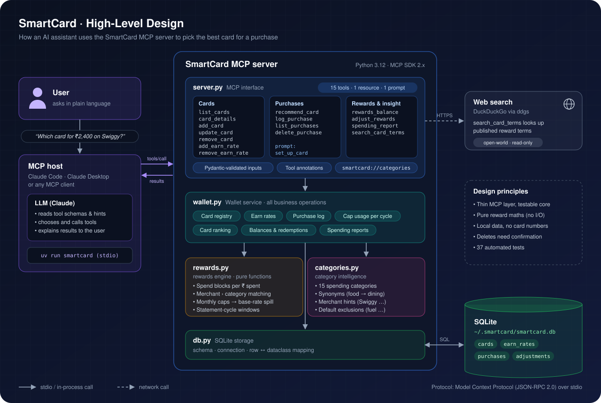
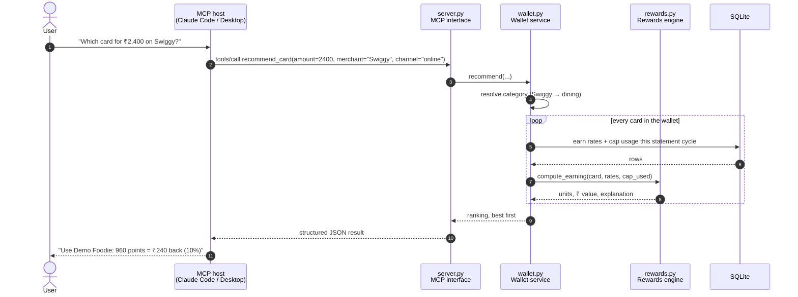

<p align="center">
  
</p>

<p align="center">
  
  
  
  
  
</p>

# SmartCard: Credit Card Rewards MCP Server

**SmartCard** is a Model Context Protocol (MCP) server that recommends the best credit card for every purchase. It tracks reward rates, monthly caps and cashback across your cards, so AI assistants like Claude Code and Claude Desktop can tell you which card to swipe.

Connect SmartCard to an AI assistant (Claude Desktop, Claude Code or any MCP client) and ask things like *"Which card for ₹5,000 on Amazon?"*. The assistant calls SmartCard's tools, which know your cards, their reward rates, monthly caps and what you have already spent this cycle, and it answers with the card that gives the most back.

## Features of the credit card recommendation server

- **Recommendations**: ranks every card by the rupee value it returns on a purchase, including how much of each monthly cap you've already used.
- **Purchase log**: records spends, calculates the rewards earned, and flags when another card would have earned more.
- **Reward balances**: points or cashback earned, plus bonuses and redemptions, valued in rupees.
- **Spending report**: spend and reward return by category and by card.
- **Card setup help**: a web search tool and a guided prompt for entering a new card's reward terms.

## Architecture

### High-level design

<p align="center">
  
</p>

The AI assistant (the **MCP host**) launches SmartCard as a subprocess and talks to it over **stdio** using the Model Context Protocol. Inside the server, each layer depends only on the one below it:

1. **Interface** (`server.py`): 15 tools, 1 resource and 1 prompt with validated inputs and tool annotations.
2. **Service** (`wallet.py`): every business operation, usable and testable without MCP.
3. **Engines** (`rewards.py`, `categories.py`): pure reward maths and category intelligence, with no I/O.
4. **Storage** (`db.py`): a single local SQLite file.

The only network call is the optional `search_card_terms` web lookup.

### Request flow

What happens when you ask *"Which card for ₹2,400 on Swiggy?"*:



### Modules

| Module | Role |
|---|---|
| `server.py` | MCP tools, resource and prompt. Thin: validates input, formats output |
| `wallet.py` | All operations (cards, rates, purchases, balances, reports) |
| `rewards.py` | Pure reward calculation: rate matching, blocks, caps, billing cycles |
| `db.py` | SQLite schema and row mapping |
| `categories.py` | Spending categories, synonyms and merchant hints |
| `models.py` | `Card`, `EarnRate`, `Purchase` dataclasses |
| `demo.py` | Loads fictional demo cards |

Built on the official [MCP Python SDK](https://github.com/modelcontextprotocol/python-sdk) 2.x (`MCPServer`). Every tool carries MCP tool annotations (read-only, writes, destructive, open-world) so clients know which calls need the user's approval. Expected failures are raised as `ToolError`, so the assistant sees a readable message such as "No card matches 'gold'" and can recover.

### Earning model

Each card earns `base_rate` units for every `block_inr` rupees spent:

| Card terms | `reward_kind` | `base_rate` | `block_inr` | `unit_value_inr` |
|---|---|---|---|---|
| 1% cashback | cashback | 1 | 100 | 1 |
| 4 points per ₹150, 1 pt = ₹0.50 | points | 4 | 150 | 0.5 |

**Earn rates** replace the base rate for a category, a merchant, or both, optionally only online or offline, and optionally with a **monthly cap** in units. When several rates match, the most specific wins (merchant > category > channel). Spend beyond a cap earns the base rate. Caps reset on the card's statement day. Categories in a card's exclusion list (by default fuel, rent, wallet loads and government payments) earn nothing.

## Setup

Requires Python 3.12+ and [uv](https://docs.astral.sh/uv/).

```bash
git clone https://github.com/ShubhamK-2907/smartcard-mcp.git
cd smartcard-mcp
uv sync
uv run pytest                 # run the tests
uv run smartcard-demo         # optional: load three fictional cards to try it out
```

Data is stored in `~/.smartcard/smartcard.db`. Set `SMARTCARD_DB` to use another file.

## Connect to an AI assistant

**Claude Code plugin (easiest).** Installs the MCP server and the SmartCard skill, which teaches the agent when and how to use each tool:

```
/plugin install smartcard --marketplace ShubhamK-2907/smartcard-mcp
```

On older Claude Code versions, run `/plugin marketplace add ShubhamK-2907/smartcard-mcp` and then `/plugin install smartcard@smartcard`. Requires [uv](https://docs.astral.sh/uv/).

**Claude Code (MCP server only)**

```bash
claude mcp add smartcard -- uv --directory /absolute/path/to/smartcard run smartcard
```

**Claude Desktop**: add to `~/Library/Application Support/Claude/claude_desktop_config.json` and restart the app:

```json
{
  "mcpServers": {
    "smartcard": {
      "command": "uv",
      "args": ["--directory", "/absolute/path/to/smartcard", "run", "smartcard"]
    }
  }
}
```

If the app can't find `uv`, use its full path (`which uv`).

To inspect the tools in a browser instead, run `uv run mcp dev src/smartcard/server.py` (MCP Inspector).

## Tools

| Tool | What it does |
|---|---|
| `list_cards` | Cards in the wallet with base rates |
| `card_details` | One card: earn rates, cap usage this cycle, balance |
| `add_card`, `update_card`, `remove_card` | Manage cards (`remove_card` asks for confirmation) |
| `add_earn_rate`, `remove_earn_rate` | Accelerated rates per category or merchant |
| `recommend_card` | Best card for a purchase, with a full ranking |
| `log_purchase`, `list_purchases`, `delete_purchase` | Purchase history |
| `rewards_balance`, `adjust_rewards` | Balances, bonuses and redemptions |
| `spending_report` | Spend and return by category and card |
| `search_card_terms` | Web search for a card's published reward terms |

Also: the resource `smartcard://categories` and the prompt `set_up_card`.

## Example conversation

> **You:** Add my HDFC Millennia card
> *Assistant runs `search_card_terms`, shows the terms, asks you to confirm, then calls `add_card` and `add_earn_rate`.*
>
> **You:** Which card for a ₹2,400 Swiggy order?
> *`recommend_card` → "Demo Foodie: 960 points worth ₹240 (10%)."*
>
> **You:** I paid ₹2,400 at Swiggy with Demo Cashback
> *`log_purchase` → logged, earned ₹72, and notes Demo Foodie would have given ₹168 more.*
>
> **You:** How am I doing this month?
> *`spending_report` → spend and reward return by category and card.*

## License

SmartCard is **source-available** under the [PolyForm Strict License 1.0.0](LICENSE).

| | Allowed? |
|---|---|
| Read the code and run it for personal, study, research or other noncommercial use | ✅ Yes |
| Use it in a commercial product or service, or inside a business | ❌ No |
| Modify it, fork it into a new work, or redistribute it | ❌ No |

For commercial licensing or any use not covered above, open an issue on this repository to contact the author.

Copyright © 2026 Shubham Kumar Sahoo. All rights not expressly granted are reserved.
